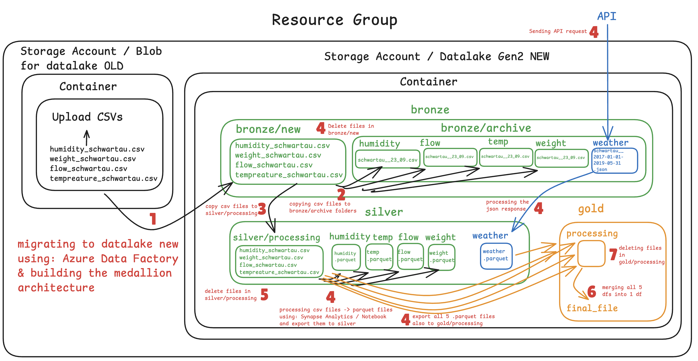

# &#x20;Bee Haven: an end-to-end Azure data pipeline for beehive sensor data

An automated **Medallion Lakehouse** (Bronze → Silver → Gold) on Microsoft Azure that cleans 2.5 years of beehive sensor data,
enriches it with historical weather from the **BrightSky API**, and delivers analysis-ready tables, orchestrated nightly by **Azure Data Factory**
and processed in **Azure Synapse** notebooks.

**Business question:** *What makes bees busy?* How do temperature, humidity and weight influence bee traffic and honey production?

[Daily bee traffic, hive temperature, humidity and weight]

---

## The data

| Source                           | Frequency | Size      | Notes                                            |
| -------------------------------- | --------- | --------- | ------------------------------------------------ |
| Bee flow (departures / arrivals) | 1 min     | 2.5M rows | Two series stacked in one file                   |
| Hive temperature                 | 5 min     | 253k rows |                                                  |
| Hive humidity                    | 12 h      | 1.8k rows |                                                  |
| Hive weight                      | 12 h      | 1.8k rows | grams                                            |
| Weather (BrightSky / DWD)        | 1 h       | 21k rows  | Temperature, rain, sunshine, wind, cloud cover … |

Period: January 2017 to May 2019, hive in Bad Schwartau and wurzburg  are added in pipeline .


## Architecture




**Orchestration (Azure Data Factory), all activities succeeded:**
`Copy` source → bronze/new → `Get Metadata` → `ForEach` (archive each file with a timestamp) → `Copy` to silver/processing
→ **Synapse Notebook 04** → `Delete` silver/processing → **Synapse Notebook 05** → `Delete` gold/processing.
A daily **schedule trigger** runs the whole chain. If a notebook's quality checks fail, the run stops and the files stay in the processing folder for inspection.

.csv)

## Repository structure

```
├── notebooks/
│   ├── 01_Data_prep_sample_solution_annotated.ipynb        # exploration + cleaning decisions, with charts
│   ├── 02_weather_sample_solution.ipynb        # BrightSky API → bronze JSON → silver Parquet
│   ├── 04_silver_processing_to_silver_and_to_gold_processing_KE_new.ipynb   # pipeline notebook (Synapse)
│   └── 05_gold_processing_to_gold_KE_new.ipynb      # pipeline notebook (Synapse): gold tables
├── data/
|   data/silver/weather/schwartau__2017-01-01-2017-01-04.json
|   data/gold/hivedata__2026-10-17T10h23m58s.parquet
|   data/gold/hivedata_clean__2026-10-17T10h24m00s.parquet
├── images/                                    # graphs + image screenshots
└── README.md

## Azure Data Lake Storage structure

The ADLS Gen2 container `newdatalakemedallion33` is organised into three medallion layers and a Synapse workspace folder:

```text
newdatalakemedallion33/                 # ADLS Gen2 container
├── bronze/
│   ├── new/                             # Incoming source files for processing
│   └── archive/                         # Timestamped copies of source files
│       ├── flow/
│       ├── humidity/
│       ├── temperature/
│       ├── weather/
│       └── weight/
├── silver/
│       ├── flow/
│       ├── humidity/
│       ├── temperature/
│       ├── weather/
│       └── weight/
│       ├── processing/                             # Cleaned and processing data
├── gold/
│   └── processing/                      # Temporary files used by the gold-processing step
└── synapse/                             # Synapse-related files, if used by the workspace
```


The exact subfolders present can vary as the pipeline runs. The pipeline copies incoming files to the archive, processes data through the silver and gold stages, and removes temporary processing files after successful notebook activities.

> **Storage note:** The container holds the data; GitHub should hold the project code, notebooks, Data Factory definitions, documentation and screenshots—not large raw or processed Parquet files.

## Azure Data Factory pipeline: implemented workflow

The `bronzenewmetadata` pipeline orchestrates the data movement and notebook processing:

1. **Copy source data** into `bronze/new`.
2. **Get Metadata** to identify the incoming files.
3. **ForEach** file: create an archive copy under `bronze/archive` with a timestamp.
4. **Copy** the selected files into `silver/processing`.
5. **Run the silver-processing Synapse notebook** to clean and prepare the data.
6. **Delete temporary silver processing files** after successful processing.
7. **Run the gold-processing Synapse notebook** to produce analysis-ready outputs.
8. **Delete temporary gold processing files** after successful processing.


## Azure implementation screenshots

The relevant portal screenshots in `image` folder

## Tech stack

| Area                   | Tools                                                                                                |
| ---------------------- | ---------------------------------------------------------------------------------------------------- |
| Storage                | Azure Data Lake Storage Gen2 (hierarchical namespace, medallion folders)                             |
| Orchestration          | Azure Data Factory: Get Metadata, ForEach, Copy, Notebook, Delete, schedule trigger, dynamic content |
| Processing             | Azure Synapse Analytics: Apache Spark pool running Python notebooks                                  |
| Language and libraries | Python, pandas, NumPy, fsspec / adlfs, requests, matplotlib                                          |
| File formats           | CSV (raw), JSON (API, semi-structured), **Parquet** (columnar, silver and gold)                      |
| Security               | Azure RBAC / IAM: managed identity for Data Factory, Synapse RBAC roles                              |
                                                  |


